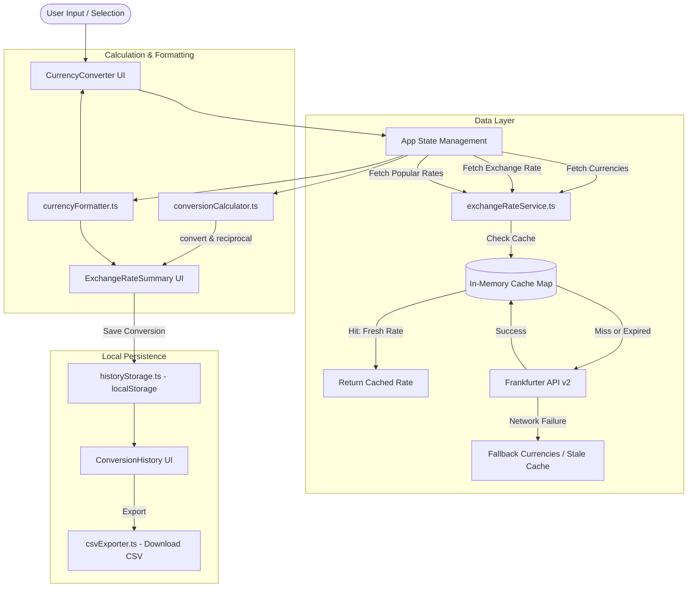

[README.md](https://github.com/user-attachments/files/33904087/README.md)
# 💱 RateFlow — Modern Currency Converter & Exchange Intelligence

RateFlow is a fast, responsive, and resilient currency conversion web application built with **React 19**, **TypeScript**, **Tailwind CSS**, and **Vite**. It provides reference exchange rates sourced from official central bank data via the Frankfurter API, featuring intelligent in-memory caching, offline fallback resilience, conversion history tracking, and CSV export capabilities.

---

## 📑 Table of Contents

1. [Features](#-features)
2. [Architecture & System Flow](#-architecture--system-flow)
3. [Component Breakdown](#-component-breakdown)
4. [Services & Utilities](#-services--utilities)
5. [Data Flow & Process Lifecycle](#-data-flow--process-lifecycle)
6. [Technology Stack](#-technology-stack)
7. [Project Structure](#-project-structure)
8. [Getting Started & Scripts](#-getting-started--scripts)
9. [Testing & Quality Assurance](#-testing--quality-assurance)
10. [Error Handling & Offline Resilience](#-error-handling--offline-resilience)

---

## 🌟 Features

- **Real-Time & Reference Currency Conversion**: Convert between 30+ major world currencies with mid-market central bank reference rates.
- **Smart In-Memory Caching**: 10-minute cache TTL minimizes redundant network requests while ensuring rate freshness.
- **Offline & Network Fallback**: Built-in fallback currency definitions prevent blank states or broken UI during network interruptions or API downtime.
- **Bidirectional Currency Swapping**: Instant 1-click swap between source and target currencies with automatic recalculation.
- **Popular Rates Dashboard**: Live comparison table of your source currency against top global currencies (`USD`, `INR`, `EUR`, `GBP`, `JPY`, `AUD`, `CAD`, `SGD`).
- **Comprehensive Conversion History**:
  - Automatically save conversions with timestamps, rates, source, and destination data.
  - Search and filter records by currency code.
  - Detailed modal view for each conversion item.
  - "Convert Again" shortcut: restores previous settings and scrolls smoothly into the converter.
  - Single record deletion and bulk history clear with confirmation.
  - Export entire history to RFC 4180-compliant `.csv` files.
- **Clean Responsive Design**: Tailored navy and emerald color palette, glassmorphism cards, micro-animations, and full mobile optimization.

---

## 🏛 Architecture & System Flow



---

## 🧩 Component Breakdown

All UI components reside in [`src/components/`](file:///c:/Users/tharu/OneDrive/Desktop/Vibe_Coding/Jarvis_agent/rateflow/src/components/):

| Component | File | Description |
| :--- | :--- | :--- |
| **Header** | [`Header.tsx`](file:///c:/Users/tharu/OneDrive/Desktop/Vibe_Coding/Jarvis_agent/rateflow/src/components/Header.tsx) | Sticky top navigation bar featuring active-tab tracking (IntersectionObserver) and mobile menu drawer. |
| **HeroSection** | [`HeroSection.tsx`](file:///c:/Users/tharu/OneDrive/Desktop/Vibe_Coding/Jarvis_agent/rateflow/src/components/HeroSection.tsx) | Minimalist introductory hero section with title and subtext. |
| **CurrencyConverter** | [`CurrencyConverter.tsx`](file:///c:/Users/tharu/OneDrive/Desktop/Vibe_Coding/Jarvis_agent/rateflow/src/components/CurrencyConverter.tsx) | Primary conversion interface handling source amount input, currency selector trigger, and the swap button. |
| **CurrencySelector** | [`CurrencySelector.tsx`](file:///c:/Users/tharu/OneDrive/Desktop/Vibe_Coding/Jarvis_agent/rateflow/src/components/CurrencySelector.tsx) | Dropdown modal with currency search, quick-select pills (`USD`, `EUR`, `INR`, etc.), and click-outside dismissal. |
| **ExchangeRateSummary** | [`ExchangeRateSummary.tsx`](file:///c:/Users/tharu/OneDrive/Desktop/Vibe_Coding/Jarvis_agent/rateflow/src/components/ExchangeRateSummary.tsx) | Live result card displaying converted totals, exchange rate, reciprocal rate (`1 quote = X base`), last updated date, stale indicators, and a "Save to History" button. |
| **PopularCurrencies** | [`PopularCurrencies.tsx`](file:///c:/Users/tharu/OneDrive/Desktop/Vibe_Coding/Jarvis_agent/rateflow/src/components/PopularCurrencies.tsx) | Grid of cards displaying current exchange rates for popular currency pairs with one-click destination selection. |
| **ConversionHistory** | [`ConversionHistory.tsx`](file:///c:/Users/tharu/OneDrive/Desktop/Vibe_Coding/Jarvis_agent/rateflow/src/components/ConversionHistory.tsx) | Table of saved conversions with search filter, details modal, re-convert trigger, record deletion, and CSV download. |
| **AboutSection** | [`AboutSection.tsx`](file:///c:/Users/tharu/OneDrive/Desktop/Vibe_Coding/Jarvis_agent/rateflow/src/components/AboutSection.tsx) | Explanatory section clarifying central bank data sources, rate frequency, and privacy guarantees. |
| **Footer** | [`Footer.tsx`](file:///c:/Users/tharu/OneDrive/Desktop/Vibe_Coding/Jarvis_agent/rateflow/src/components/Footer.tsx) | Footer with API attribution and copyright information. |

---

## ⚙ Services & Utilities

### 1. Exchange Rate Service ([`src/services/exchangeRateService.ts`](file:///c:/Users/tharu/OneDrive/Desktop/Vibe_Coding/Jarvis_agent/rateflow/src/services/exchangeRateService.ts))
- **`fetchCurrencies()`**: Retrieves supported currencies from `https://api.frankfurter.dev/v2/currencies`. If network requests fail, automatically falls back to [`FALLBACK_CURRENCIES`](file:///c:/Users/tharu/OneDrive/Desktop/Vibe_Coding/Jarvis_agent/rateflow/src/data/fallbackCurrencies.ts).
- **`fetchRate(base, quote)`**: Fetches pair rates (`/rate/{base}/{quote}`). Uses in-memory Map cache (`rateCache`) with a 10-minute TTL. Includes a 12-second abort timeout. Returns stale cached rates gracefully if network fails.
- **`fetchRates(base, quotes)`**: Fetches multiple rates at once (`/rates?base={base}&quotes={quotes}`) for popular currencies.
- **`isRateStale(rate)`**: Checks whether cached data exceeds the 10-minute validity threshold.
- **`clearRateCache()`**: Wipes memory cache (used during testing or manual reloads).

### 2. Conversion Calculator ([`src/utils/conversionCalculator.ts`](file:///c:/Users/tharu/OneDrive/Desktop/Vibe_Coding/Jarvis_agent/rateflow/src/utils/conversionCalculator.ts))
- **`convert(amount, rate)`**: Computes `amount * rate`. Returns `0` for non-positive rates.
- **`reciprocal(rate)`**: Computes `1 / rate` for reverse conversion calculations.
- **`isValidAmount(val)`**: Validates that numeric inputs are non-null, finite, and non-negative.

### 3. Currency Formatter ([`src/utils/currencyFormatter.ts`](file:///c:/Users/tharu/OneDrive/Desktop/Vibe_Coding/Jarvis_agent/rateflow/src/utils/currencyFormatter.ts))
- **`parseAmount(raw)`**: Sanitizes input strings into positive numbers or returns `null` for invalid input.
- **`formatNumber(val, decimals)`**: Formats numeric strings with standard comma thousand separators (`1,234,567.89`).
- **`formatRate(rate)`**: Dynamically selects decimal precision (up to 6 decimals for sub-cent values) for readability.
- **`formatDate(iso)`** and **`formatTimestamp(ms)`**: Converts dates and UNIX timestamps to locale strings.

### 4. History Storage ([`src/utils/historyStorage.ts`](file:///c:/Users/tharu/OneDrive/Desktop/Vibe_Coding/Jarvis_agent/rateflow/src/utils/historyStorage.ts))
- Safely manages `localStorage` under key `rateflow_conversion_history`.
- Validates data structure on load to protect against corrupted or malformed data.
- Provides atomic operations: `loadHistory`, `saveHistory`, `addRecord`, `deleteRecord`, and `clearHistory`.

### 5. CSV Exporter ([`src/utils/csvExporter.ts`](file:///c:/Users/tharu/OneDrive/Desktop/Vibe_Coding/Jarvis_agent/rateflow/src/utils/csvExporter.ts))
- Generates RFC 4180-compliant CSV text with proper quotation and escaping.
- Creates and triggers a browser blob download (`RateFlow_Conversions_YYYY-MM-DD.csv`).

---

## 🔄 Data Flow & Process Lifecycle

### 1. Initialization
1. `App.tsx` mounts and invokes `fetchCurrencies()`.
2. Simultaneously, `loadHistory()` populates existing records from `localStorage`.
3. If currency API responds, full currency list loads; if it errors, the app seamlessly defaults to 30+ fallback currencies.

### 2. Conversion Calculation
1. User types an amount or changes currencies (`sourceCurrency`, `destinationCurrency`).
2. If `sourceCurrency === destinationCurrency`, identity rate `1.0` is instantly applied with zero network latency.
3. If currencies differ, `fetchRate` checks memory cache:
   - **Cache Hit (<10 min old)**: Returns stored rate immediately.
   - **Cache Miss / Stale**: Dispatches an HTTP GET request to Frankfurter API.
4. Calculated values (`destinationAmount = amount * rate`) update reactively across the interface.

### 3. Popular Rates Refresh
1. Whenever `sourceCurrency` changes, `fetchRates` requests rates for `USD, INR, EUR, GBP, JPY, AUD, CAD, SGD`.
2. The grid updates to show relative purchasing power and rates.

### 4. History Saving & Exporting
1. User clicks **"Save Conversion"**.
2. A record is constructed with a unique ID (`generateId()`), timestamp, amounts, rate, provider, and stale status.
3. Record prepends to `localStorage` and the history table updates in real time.
4. Clicking **"Export CSV"** converts all records into a spreadsheet-ready file.

---

## 🛠 Technology Stack

- **Framework**: [React 19](https://react.dev/) + [TypeScript](https://www.typescriptlang.org/)
- **Bundler & Tooling**: [Vite 6](https://vitejs.dev/)
- **Styling**: [Tailwind CSS 3.4](https://tailwindcss.com/) + PostCSS + Autoprefixer
- **Icons**: [Lucide React](https://lucide.dev/)
- **Testing**: [Vitest 3](https://vitest.dev/) + [Testing Library](https://testing-library.com/) + [JSDOM](https://github.com/jsdom/jsdom)
- **API Provider**: [Frankfurter API](https://frankfurter.dev/) (European Central Bank and 100+ national central banks data)

---

## 📂 Project Structure

```text
rateflow/
├── public/                 # Static assets
├── src/
│   ├── __tests__/          # Unit test suites (Vitest)
│   │   └── utils.test.ts   # Tests for calculator, formatter, CSV, and storage
│   ├── components/         # Modular UI React components
│   │   ├── AboutSection.tsx
│   │   ├── ConversionHistory.tsx
│   │   ├── CurrencyConverter.tsx
│   │   ├── CurrencySelector.tsx
│   │   ├── ExchangeRateSummary.tsx
│   │   ├── Footer.tsx
│   │   ├── Header.tsx
│   │   ├── HeroSection.tsx
│   │   └── PopularCurrencies.tsx
│   ├── data/
│   │   └── fallbackCurrencies.ts  # Hardcoded fallback list for offline resilience
│   ├── services/
│   │   └── exchangeRateService.ts # API communication, caching & timeout handling
│   ├── utils/
│   │   ├── conversionCalculator.ts# Mathematical conversion & reciprocal calculations
│   │   ├── csvExporter.ts         # CSV generation and download helper
│   │   ├── currencyFormatter.ts   # Decimal and currency formatting utilities
│   │   └── historyStorage.ts      # LocalStorage persistence & JSON sanitization
│   ├── App.tsx             # Root application orchestrator
│   ├── index.css           # Global Tailwind CSS styles and custom gradient classes
│   ├── main.tsx            # React application entry point
│   ├── types.ts            # Centralized TypeScript interfaces
│   └── vite-env.d.ts       # Vite client types
├── dist/                   # Production build distribution
├── index.html              # HTML template with Google Fonts (Outfit & Plus Jakarta Sans)
├── package.json            # Scripts & project dependencies
├── postcss.config.js       # PostCSS configuration
├── tailwind.config.js      # Tailwind theme configuration
├── tsconfig.json           # TypeScript configuration
└── vite.config.ts          # Vite build and test configuration
```

---

## 🚀 Getting Started & Scripts

### Prerequisites
- Node.js (version 18+ recommended)
- npm or yarn

### Installation
Clone or navigate to the `rateflow` folder and install dependencies:
```bash
cd rateflow
npm install
```

### Available Scripts

| Command | Action |
| :--- | :--- |
| `npm run dev` | Starts Vite local development server with Hot Module Replacement (HMR). |
| `npm run build` | Runs TypeScript typecheck (`tsc -b`) and builds production bundle into `dist/`. |
| `npm run preview` | Starts local HTTP server to preview the production build. |
| `npm test` | Runs the Vitest test suite. |

---

## 🧪 Testing & Quality Assurance

RateFlow includes a comprehensive unit test suite covering pure business logic:
- **Conversion Calculations**: Zero amounts, negative rates, fractional figures, precision validation.
- **Reciprocal Math**: Identity rates, inverse calculations, boundary handling.
- **Currency Formatters**: Numeric string parsing, decimal preservation, large number thousand-separators.
- **CSV Generator**: RFC header compliance, field escaping, empty-state behavior.
- **History Storage**: Save, load, deletion, clear, and recovery from corrupted JSON.

Run tests using:
```bash
npm test
```

---

## 🛡 Error Handling & Offline Resilience

1. **Network Failure & Timeout**: All network fetch calls are bounded by a 12-second abort timeout.
2. **Stale Cache Fallback**: If an update fails due to network outage, previously cached rates are returned with an `isStale` flag to inform the user.
3. **Dropdown Immunity**: The currency dropdown never renders empty; if the `/currencies` endpoint fails, `FALLBACK_CURRENCIES` guarantees uninterrupted usage.
4. **LocalStorage Shield**: `historyStorage.ts` validates JSON schemas on read and wraps writes in `try/catch` to guard against quota limits or private browsing restrictions.
